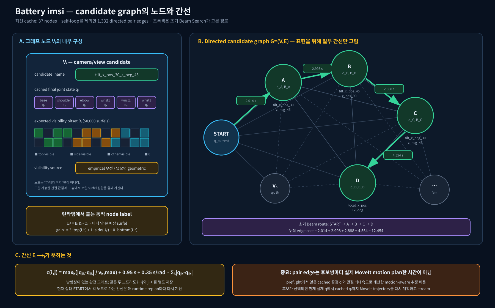
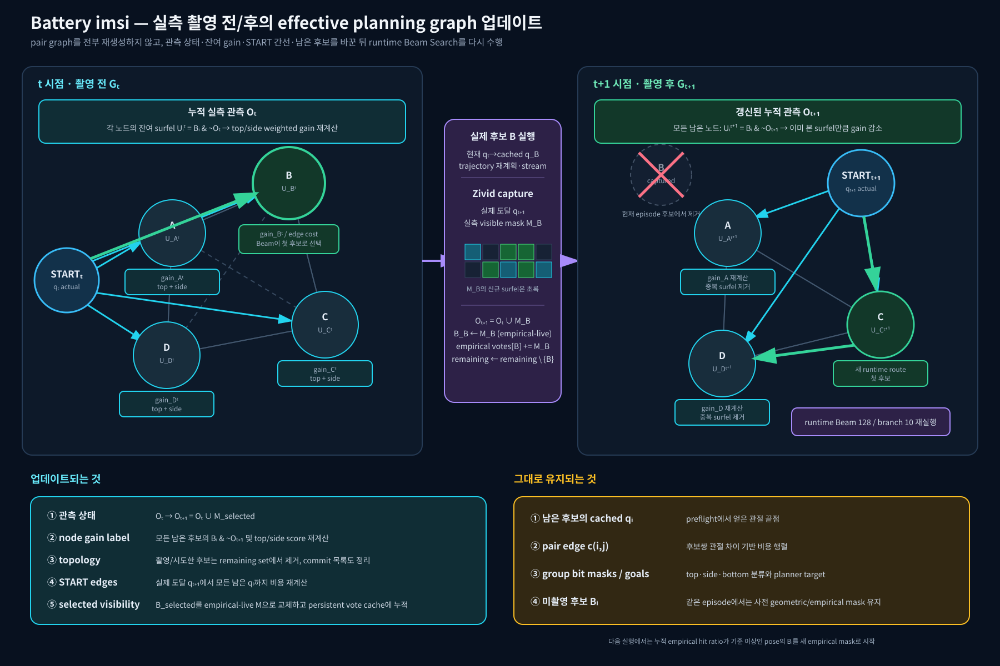

# Battery `imsi` graph 상세 시각화

## 노드와 간선

- 노드 `Vᵢ`: 후보 이름, preflight에서 얻은 cached joint endpoint `qᵢ`, 예상 visible-surfel bitset `Bᵢ`.
- pair edge `c(i,j)`: 후보쌍의 실제 MoveIt plan 시간이 아니라 `qᵢ → qⱼ` 관절 차이로 계산한 motion-aware 추정 비용.
- START edge: 현재 실제 관절 상태에서 각 후보로 가는 비용이며 runtime replan 때마다 다시 계산한다.
- 최신 cache는 37개 노드와 self-loop를 제외한 1,332개 directed pair edge를 가진다.

## 실측 촬영 뒤의 effective graph 업데이트

촬영 뒤에는 전체 pair graph를 다시 만들지 않는다. 누적 관측 `O`, 남은 후보 집합, 각 노드의 residual gain, 현재 자세에서 시작되는 edge를 갱신한 뒤 runtime beam search를 다시 실행한다. 선택한 pose의 측정 visibility는 `empirical-live`로 바뀌며 persistent empirical vote cache에도 누적된다.

관련 코드:

- node visibility 및 pair edge 구성: `Battery_nbv_arm_runner_utils.py:2485-2672`
- residual bit 계산: `Battery_nbv_arm_runner_utils.py:322-370`
- runtime START edge 및 beam 재계획: `Battery_nbv_arm_runner_utils.py:3300-3324`
- 촬영 후 observed/empirical 갱신: `Battery_nbv_arm_runner_utils.py:4269-4298`
