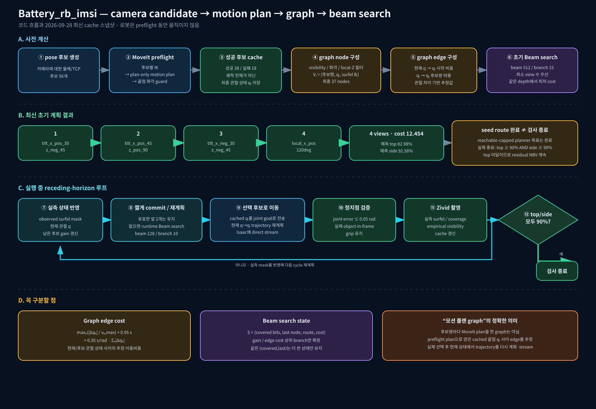

# Battery `imsi` motion-aware NBV 흐름



결론부터 말하면, 질문한 순서는 맞다. 다만 구현상 정확한 표현은 아래와 같다.

1. 모든 카메라 후보에 대해 로봇을 움직이지 않는 `IK + plan-only motion plan`을 수행한다.
2. 성공 후보에서 계획 궤적 전체가 아니라 **계획 궤적의 최종 관절 상태** `qᵢ`를 저장한다.
3. 성공 후보별 visibility bitset `Bᵢ`와 후보쌍의 관절 이동 추정 비용을 계산한다.
4. 이 graph ingredients를 이용해 초기 beam search를 실행한다.
5. 그 뒤 graph와 초기 경로를 `.npz`/`.json`에 저장한다.
6. 실제 촬영 중에는 실측 observed mask를 반영해 runtime beam search를 반복한다. 즉, 고정 경로 재생이 아니라 receding-horizon planner다.

중요한 구분: graph의 후보 간 edge cost는 후보쌍마다 MoveIt motion planning을 새로 수행한 결과가 아니다. 사전 planning으로 얻은 최종 관절 상태 사이의 차이와 관절 최대속도로 만든 추정 비용이다. 실제 실행 시에는 선택된 cached joint goal까지 현재 상태에서 MoveIt trajectory를 다시 계획하고 Isaac으로 stream한다.

## 최신 cache 스냅샷

- 생성 시각: `2026-09-28T07:58:38`
- 후보 시도: 56개
- preflight 성공: 38개
- route graph 후보: 37개
- 초기 beam: `beam_width=512`, `branch_width=15`
- runtime beam: `beam_width=128`, `branch_width=10`
- 초기 경로: `tilt_x_pos_30_z_neg_45 → tilt_x_pos_45_z_pos_90 → tilt_x_neg_30_z_neg_45 → local_x_pos_120deg`
- 초기 경로 비용: `12.4541`
- 초기 예측 coverage: top `82.98%`, side `92.58%`

초기 경로는 reachable-capped planner goal을 만족하지만 실제 종료 목표인 top/side 각각 90% 중 top을 만족하지 않는다. 따라서 코드가 residual NBV를 계속 수행하는 것이 정상이다.

## 그래프 상세 그림

- [노드와 directed edge 구성](./Battery_imsi_graph_anatomy.svg)
- [실측 촬영 전/후 effective graph 업데이트](./Battery_imsi_graph_runtime_update.svg)
- [상세 설명 문서](./Battery_imsi_graph_visualization.md)

원본 데이터:

- `zivid_capture/object_occupancy/nbv_precomputed_joint_views.json`
- `zivid_capture/object_occupancy/nbv_precomputed_route_graph.npz`
- `zivid_capture/object_occupancy/nbv_precomputed_route_graph.json`

상세 Graphviz 다이어그램 재생성:

```bash
dot -Tsvg rb_ws/docs/Battery_imsi_route_flow.dot \
  -o rb_ws/docs/Battery_imsi_route_flow.svg
dot -Tpng -Gdpi=150 rb_ws/docs/Battery_imsi_route_flow.dot \
  -o rb_ws/docs/Battery_imsi_route_flow.png
```
